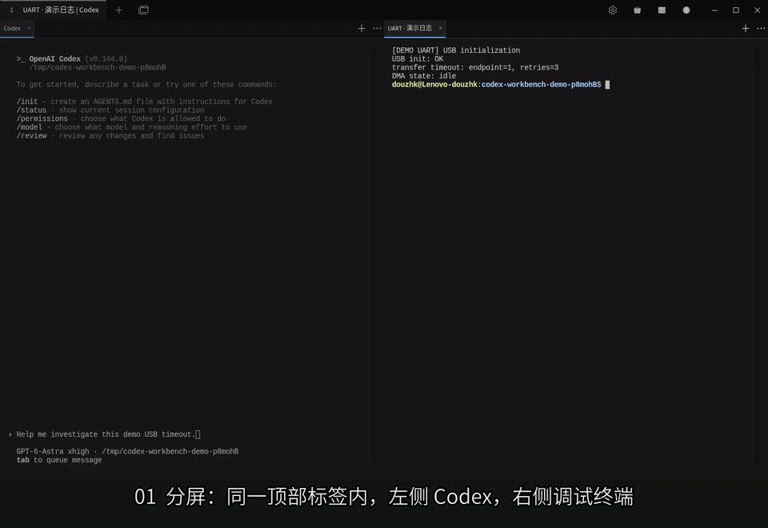

# Codex Workbench

基于 **Tabby 终端 + 原版 Codex CLI** 的多终端调试工作台。目标是在保持日常终端操作方式的基础上，让 Shell、串口和 GDB 的输出更方便地进入当前 Codex 对话，并支持继续扩展插件。

典型用法：左侧运行 Codex，右侧分别打开串口和 GDB；在右侧选中日志，按 **Ctrl+Shift+Y**，内容进入左侧 Codex 的未发送草稿，再补充问题并自行发送。

这是独立社区项目，与 Tabby、OpenAI 无官方隶属或背书关系。

## 功能演示

[](https://github.com/dzkcoming/codex-workbench/raw/refs/heads/main/docs/demo/workbench-demo.mp4)

[观看完整视频（MP4，中文字幕）](https://github.com/dzkcoming/codex-workbench/raw/refs/heads/main/docs/demo/workbench-demo.mp4) · [演示内容与录制说明](docs/demo/README.md)

## 与原版 Tabby 的关系

本仓库交付的是 **Tabby 插件、工作台配置和安装启动脚本**。安装脚本下载并校验官方 **Tabby 1.0.238**，插件加载到独立配置目录 `~/.config/tabby-codex`；当前没有修改或重新编译 Tabby 上游源码、替换官方终端内核。

下表描述基于该版本新增或调整的行为。分屏、Shell、SSH、串口连接本身由 Tabby 提供；本项目的主要改动集中在分屏内标签、跨终端引用、网页整合和交互方式。

| 方面 | 本工作台的新增或调整 |
| --- | --- |
| 分屏内标签 | 保留原来的顶部标签，每个分屏再拥有自己的终端/网页标签栏，各分屏独立切换 |
| 新建终端 | 分屏内按 Ctrl+Shift+T 或点击“＋”，在当前分屏新增标签；新建本地 Shell 优先继承来源终端实时工作目录 |
| 标签命名 | 双击分屏内部标签即可修改名称；布局、名称和选中项接入 Tabby 恢复机制 |
| 键盘导航 | Alt+1～9 切换当前分屏内部标签，Alt+方向键按位置切换分屏焦点 |
| 正文右键菜单 | 精简为复制、粘贴、向右分屏、向下分屏、引用到 Codex 五项；其他管理入口保留在标签栏或设置中 |
| 分屏浮层 | 工作台配置取消原生 Ctrl+Shift 重新排列分屏绑定，避免仅按修饰键就显示终端名称浮层 |
| 引用到 Codex | 选区直接插入同一顶部工作页内接收分屏当前显示的 Codex 草稿，保留已有输入，不自动提交 |
| 固定引用与引用篮 | 保存选区、来源和时间等信息；支持历史查看，以及备用的多条收集、备注、排序与复制 |
| 网页 / 本地 HTML | 在分屏内部打开网页，与终端共用标签切换、改名和布局恢复 |
| 扩展接口 | 导出引用服务和操作扩展接口，提供独立插件示例及可选的只读 MCP |

普通单终端页面的 Ctrl+Shift+T 仍新建顶部标签，Alt+数字仍切换顶部标签。进入分屏内部标签容器后，才使用内部标签规则。隐藏终端继续运行和接收输出。

## 日常引用流程

1. 在设置的 **Codex 引用** 中选择本机项目目录。
2. 在普通终端进入项目并运行 `codex`，通过正文右键创建左右或上下分屏。
3. 在其他分屏打开调试终端，选中输出，右键 **引用到 Codex** 或按 **Ctrl+Shift+Y**。
4. 回到 Codex，补充问题后自行提交。引用成功时焦点仍留在来源终端，剪贴板不变。

接收目标按**分屏**记忆：该分屏切换到另一个 Codex 标签后，后续引用跟随当前显示项。多个可见 Codex 分屏时，首次选择接收分屏；也可在顶部标签栏右键的 **Codex 引用 → 选择接收引用的分屏…** 中更换。隐藏标签和其他顶部工作页不接收。

每次引用保存不可变快照。短选区插入内容与来源，超过 4000 字符时插入完整快照路径。快照位于所选项目的 `.terminal-references/`，不随终端后续输出改变。备用引用篮通过顶部标签栏菜单收集，按 **Ctrl+Shift+B** 打开整理页。

自动投递目前针对 **Linux 本机前台运行的 Codex**，通过进程和终端界面保守识别输入状态。目标退出、切到 Shell、处于选择菜单或无法确认时，改为复制并提示手动粘贴。SSH/tmux 内的 Codex 不支持自动投递；右侧引用来源仍可使用 Tabby 的 SSH、串口等终端。终端界面识别不等于 Codex 的结构化编辑器 API，不能保证与其内部状态原子同步。

## 网页与插件扩展

点击工具栏地球图标，或分屏 **⋯ → 在此分屏打开网页 / HTML…**，即可打开 HTTP/HTTPS 地址或本地 HTML。支持地址栏、后退、前进、刷新和本地文件选择。网页组件基于 **tabby-browser 0.2.0** 定制，已整合到本插件中。

网页与终端共用内部标签；网页中的 Ctrl+Shift+T 仍用于新建终端。网页选区目前通过普通复制使用，尚未接入终端固定引用流程。

插件导出 `ReferenceActionProvider`、`ReferencesService` 和 `ReferenceSummary`，独立插件可为引用增加操作。示例见 [source-label](tabby/examples/source-label/index.ts)。可选只读 MCP 提供 `reference_list`、`reference_read`、`reference_search`，详见 [插件说明](tabby/README.md)。

## 实现边界

- 普通终端输入与设备输出继续使用 Tabby 原有通路；插件没有添加 PTY 收发代理或持续采集终端输出。创建引用时按需处理当前选区。
- Codex 由用户在普通终端自行启动，继续管理自己的登录、模型、审批、技能和会话。工作台不修改 Codex 程序；可选 MCP 启动器仅为该次进程追加配置。
- 布局恢复会重新启动或连接终端，不保留退出应用前的进程。Codex 会话恢复仍使用其原生 `resume`。
- Tabby 退出会关闭它持有的串口连接；当前桌面插件不提供退出后的后台持续采集。
- 插件有针对 Tabby 1.0.238 的焦点与快捷键适配。升级宿主需要重新验证，不能保证所有版本兼容或零性能开销。

## 安装与启动

当前安装脚本面向 **Linux x86_64**，需要 npm、Python 3、`dpkg-deb` 及相关原生依赖构建工具。Codex CLI 需自行安装并登录。

在仓库根目录准备本地 Node 运行时及依赖，再安装插件：

```bash
npm install --prefix .runtime --save-exact node@22.23.4
source scripts/runtime.sh
npm ci
./setup-tabby.sh
./start-tabby.sh
```

脚本将官方 Tabby 解包到 `.runtime/tabby-app`，为插件创建安装链接，并添加 **Tabby · Codex 引用** 桌面入口。修改插件并重新构建后，已打开的 Tabby 需重启才能加载新版；请先结束当前调试工作。

## 源码与验证

| 位置 | 职责 |
| --- | --- |
| `tabby/src/pane-tabs.ts` | 分屏内部标签、工作目录继承、快捷键、布局与焦点适配 |
| `tabby/src/codex-reference.ts`、`codex-target.ts` | 接收分屏选择、Codex 检查与草稿投递 |
| `tabby/src/index.ts` | 菜单、设置、快捷键与扩展接口集成 |
| `tabby/src/browser-tab.ts`、`browser-host.ts` | 网页视图、分屏整合和网页快捷键 |
| `tabby/src/references.ts`、`basket.ts`、`reference-basket.ts` | 不可变引用、引用篮与整理界面 |
| `tabby/src/worker.ts`、`mcp.ts` | 按需后台处理与只读 MCP |
| `scripts/install-tabby.py`、`setup-tabby.sh`、`start-tabby.sh` | 官方应用下载校验、配置、安装和启动 |
| `tabby/test/`、`tests/tabby-*.mjs` | 领域测试与真实桌面集成测试 |

```bash
source scripts/runtime.sh
npm run check:tabby
npm run build:tabby
npm run test:tabby
npm run test:tabby:direct-reference
```

直接引用已在真实 Tabby 1.0.238 + Codex 0.164.0 上通过九项集成检查，并完成菜单、引用篮和分屏导航回归。测试结合实际键盘/菜单操作、终端输入与进程状态断言，部分布局辅以截图检查。详细结果与限制见 [VALIDATION.md](VALIDATION.md)；测试产物保存在本地 `test-results/`，不随源码提交。

## 上游与许可证

- [Tabby](https://github.com/Eugeny/tabby)：MIT；保留 [上游许可证](tabby/licenses/Tabby-MIT.txt)。
- [tabby-browser](https://github.com/karolnowacki/tabby-browser)：MIT；已保留许可证、作者和本地改动说明，见 [第三方代码说明](tabby/licenses/README.md)。
- `protocol/` 是早期 Web 方案使用的 Codex 生成协议类型，来源、Apache-2.0 许可证及上游 NOTICE 见 [protocol/README.md](protocol/README.md)。

**本仓库自有代码尚未选择发布许可证**，上述上游许可证不代表整个仓库已经统一采用 MIT。发布方式、现有声明及待处理项见 [许可证检查](LICENSE_REVIEW.md)。

## 更多文档

- [Tabby 功能使用与开发说明](tabby/README.md)
- [设计与阶段记录](codex-terminal-workbench-design.md)
- [早期 Web 工作台](WEB_WORKBENCH.md)：保留 React、独立采集服务和 Codex App Server 方案；与当前 Tabby 插件分开运行。
